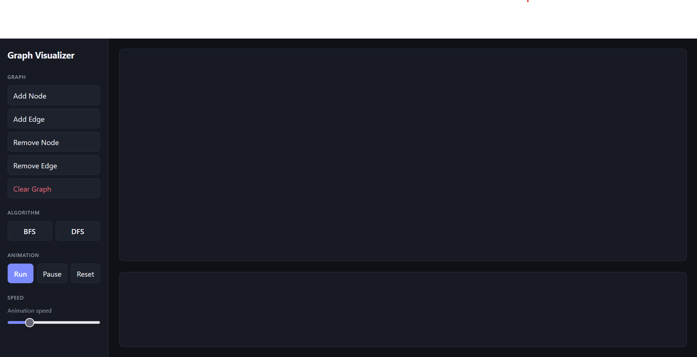
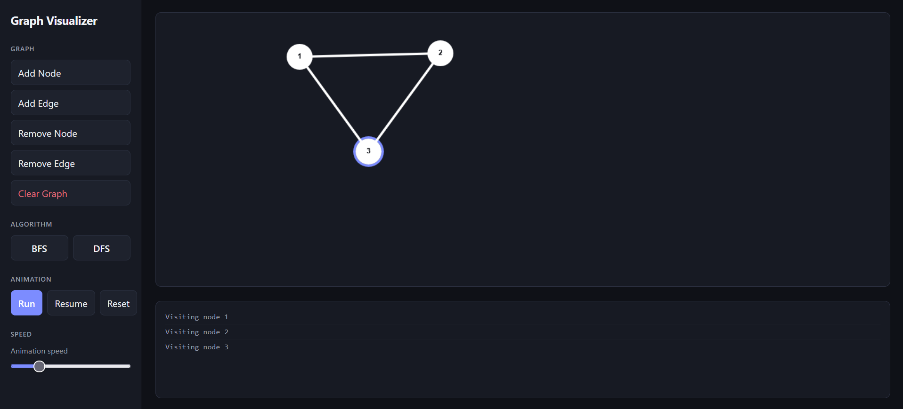

# Graph Algorithm Visualizer

An interactive web application for visualizing graph traversal algorithms, including Breadth-First Search (BFS) and Depth-First Search (DFS).

## Features

- **Interactive graph creation** — add and remove nodes and edges.
- **Graph traversal** — run BFS and DFS from a selected starting node.
- **Step-by-step visualization** — follow the traversal as nodes are visited.
- **Animation controls** — pause, resume, reset, and adjust the animation speed.
- **Traversal log** — follow the algorithm's execution through a log of visited nodes.

## Technologies

- HTML
- CSS
- JavaScript (ES modules)
- HTML Canvas API

## Getting Started

### Prerequisites

- A web browser
- Visual Studio Code with the Live Server extension

### Running the Application

1. Clone or download this repository.
2. Open the project folder in Visual Studio Code.
3. Open `index.html` and select **Open with Live Server**.
4. The application will open in your browser.

No additional dependencies are required.

## Algorithms

**Breadth-First Search (BFS)** explores a graph level by level, using a queue.

**Depth-First Search (DFS)** explores as far as possible along each branch before backtracking, using a stack.

Both algorithms have a time complexity of \(O(V + E)\), where \(V\) is the number of vertices and \(E\) is the number of edges, assuming an adjacency-list representation.

## Screenshots

 

## Future Improvements

- Support for additional graph algorithms
- Further visualization and usability improvements

## License

This project is licensed under the MIT License. See the `LICENSE` file for details.